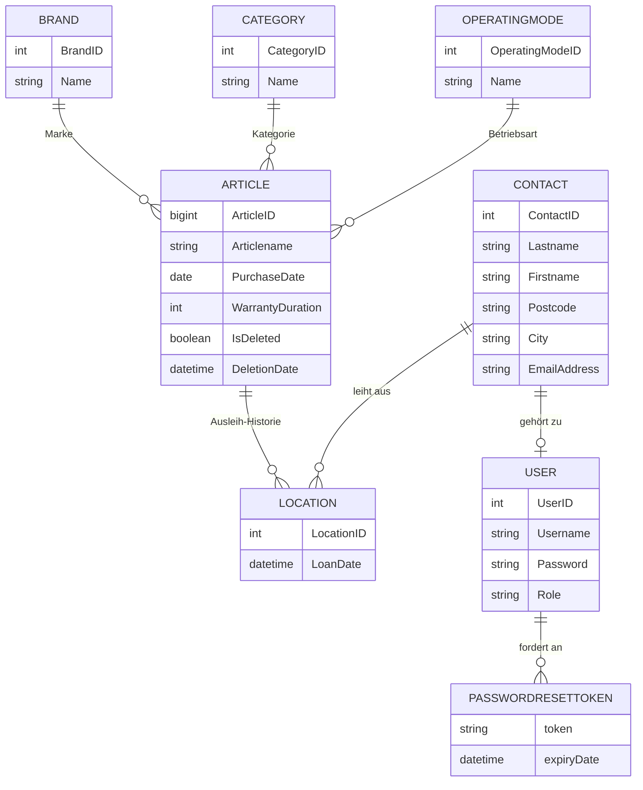

# Maschinenpark – Inventarverwaltung

Webapplikation zur Verwaltung eines **Maschinen- und Werkzeugbestands** inklusive **interner Ausleihe**,
**Ausleih-Historie** und **Etikettendruck**. Wo ist welches Gerät, wer hat es ausgeliehen und seit wann?
Die Applikation beantwortet diese Fragen auf einen Blick.

Entstanden im Rahmen meiner Ausbildung zur **Informatikerin EFZ Applikationsentwicklung** und
danach eigenständig weiterentwickelt.


---

## Inhalt

- [Über das Projekt](#über-das-projekt)
- [Funktionen](#funktionen)
- [Screenshots](#screenshots)
- [Technologien](#technologien)
- [Architektur](#architektur)
- [Datenmodell](#datenmodell)
- [Sicherheit](#sicherheit)
- [Installation & Start](#installation--start)
- [Testbenutzer](#testbenutzer)
- [Herausforderungen & Learnings](#herausforderungen--learnings)
- [Ausblick](#ausblick)
- [Kontakt](#kontakt)

---

## Über das Projekt

**Ausgangslage:** Ein Betrieb mit vielen Maschinen und Werkzeugen lagert diese an verschiedenen Orten
und leiht sie intern aus. Wo sich ein Gerät gerade befindet und wer es hat, lässt sich nur mühsam
herausfinden. Suchzeiten und Fehlkäufe sind die Folge.

**Lösung:** Eine zentrale Webapplikation, in der jeder Artikel mit Marke, Kategorie, Betriebsart,
Kaufdatum und Garantie erfasst ist. Jede Ausleihe wird chronologisch festgehalten, sodass der aktuelle
Standort und die komplette Historie direkt am Artikel sichtbar sind.

| | |
|---|---|
| **Art** | Ausbildungsprojekt, Einzelarbeit, danach weiterentwickelt |
| **Ausbildung** | Informatikerin EFZ Applikationsentwicklung, Bénédict-Schule Zürich |
| **Projektmethode** | HERMES 2022 |
| **Jahr** | 2025 |

## Funktionen

### Inventar
- **Artikel erfassen, bearbeiten und archivieren**: Bezeichnung, Marke, Kategorie
  (Handwerkzeug, Messwerkzeug, Elektrowerkzeug, Maschinen), Betriebsart (Akku, 220V, 380V, Hand),
  Kaufdatum und Garantiedauer
- **Soft Delete**: Gelöschte Artikel werden mit Löschdatum markiert statt physisch entfernt, damit die
  Historie erhalten bleibt
- **Filter** nach ID, Name, Marke, Kategorie, Betriebsart, Kaufdatum, Garantie und Status
- **Stammdaten verwalten**: Marken, Kategorien und Betriebsarten direkt in der Applikation pflegen.
  Werte, die noch verwendet werden, können nicht gelöscht werden

### Ausleihe & Historie
- **Ausleihen** eines Artikels an einen Kontakt mit Ausleihdatum
- **Chronologische Historie** pro Artikel: wer hatte das Gerät wann
- **Rückgabe** durch Ausleihe an den Standardkontakt (Lager/Firma)
- Kontakte mit aktiven Ausleihen sind vor dem Löschen geschützt

### Export & Druck
- **CSV-Export** des gesamten Inventars inklusive letzter Ausleihe und Kontaktdaten
- **Etikettendruck** pro Artikel: Die Applikation erzeugt ZPL-Code und sendet ihn über das Netzwerk
  (Port 9100) an einen Zebra-Etikettendrucker

### Benutzer & Zugang
- **Login** mit E-Mail und Passwort
- **Passwort vergessen**: Link per E-Mail mit einmaligem Token, 24 Stunden gültig
- **Benutzerverwaltung** (nur Admin): Benutzer anlegen, Rolle vergeben, löschen

### Rollen

| Funktion | Mitarbeiter (`ROLE_EMPLOYEE`) | Administrator (`ROLE_ADMIN`) |
|---|:---:|:---:|
| Artikel erfassen, bearbeiten, ausleihen | ✅ | ✅ |
| Kontakte und Stammdaten verwalten | ✅ | ✅ |
| CSV-Export und Etikettendruck | ✅ | ✅ |
| Benutzerverwaltung | ❌ | ✅ |
| Administrationsansicht `/admin` | ❌ | ✅ |

## Screenshots

> Screenshots folgen. Ablage: `docs/screenshots/`

<!--


-->

## Technologien

| Bereich | Technologie |
|---|---|
| Sprache | Java 21 |
| Backend | Spring Boot 3.4, Spring Data JPA (Hibernate), Spring Security, Bean Validation, Spring Mail |
| Frontend | Vaadin Flow 24.7 (serverseitige UI in Java), Line Awesome Icons |
| Datenbank | MariaDB |
| Build | Maven (Wrapper enthalten) |
| Deployment | Docker, Docker Compose |
| Weitere | OpenCSV (Export), ZPL (Etikettendruck), Lombok |
| Tools | IntelliJ IDEA, Git & GitHub, Draw.io, Visual Paradigm |

## Architektur

Schichtenarchitektur nach dem **MVC-Prinzip**:

```
src/main/java/ch/jacqueline/inventory
├── config        # Spring Security Konfiguration, aktueller Benutzer
├── controller    # REST-Endpunkte (Passwort-Reset, CSRF-Token, Artikel, Kontakte)
├── entity        # JPA-Entitäten
├── repository    # Spring Data JPA Repositories
├── services      # Geschäftslogik, E-Mail-Versand, Etikettendruck
├── security      # Verschlüsselung (AES-GCM) und Schlüsselverwaltung
├── filters       # Filterlogik für die Artikelübersicht
├── export        # CSV-Export
└── views         # Vaadin Views (Login, Mitarbeiter, Administration, Passwort-Reset)
```

## Datenmodell



Die Tabelle `Location` bildet die **Ausleih-Historie**: Jede Ausleihe ist ein neuer Eintrag. Daraus
ergeben sich der aktuelle Standort (letzter Eintrag) und die komplette Chronologie eines Artikels.

## Sicherheit

- **Spring Security mit Vaadin** (`VaadinWebSecurity`): Alle Ansichten ausser Login und Passwort-Reset
  erfordern eine Anmeldung, die Administrationsansicht ist über `@RolesAllowed("ADMIN")` geschützt
- **Passwörter** werden mit **BCrypt** gehasht
- **CSRF-Schutz** auch für die REST-Endpunkte
- **Verschlüsselung sensibler Kontaktdaten** in der Datenbank mit **AES-GCM** über einen
  JPA-`AttributeConverter`; die E-Mail bleibt für die Suche im Klartext
- **Passwort-Reset-Tokens** sind einmalig und laufen nach 24 Stunden ab

> **Hinweis:** Die Schlüssel und Zugangsdaten in `application.properties` und `docker-compose.yml`
> sind **reine Demo-Werte** für den lokalen Betrieb. Für einen produktiven Einsatz gehören sie in
> Umgebungsvariablen oder einen Secret Store.

## Installation & Start

### Voraussetzungen

- [Docker Desktop](https://www.docker.com/products/docker-desktop/)
- **JDK 21** und **Node.js** (für den Vaadin-Build)

### Variante 1: Mit Docker

Der Docker-Container verwendet die fertig gebaute JAR-Datei, deshalb zuerst bauen:

```bash
git clone https://github.com/Jaybi1989/InventoryManagement.git
cd InventoryManagement
./mvnw clean package -Pproduction     # Windows: mvnw.cmd clean package -Pproduction
docker compose up --build
```

Die Applikation ist danach unter **http://localhost:8082** erreichbar.

### Variante 2: Lokal entwickeln

Nur die Datenbank im Container starten und die Applikation lokal ausführen:

```bash
docker compose up -d db
./mvnw spring-boot:run                # Windows: mvnw.cmd spring-boot:run
```

Die Applikation ist danach unter **http://localhost:8080** erreichbar.

Tabellen und Testdaten liegen im Ordner [`sql/`](sql/).

## Testbenutzer

| Login (E-Mail) | Passwort | Rolle |
|---|---|---|
| `info@example.ch` | `Admin123!` | Administrator |
| `anna@example.com` | `Admin123!` | Administrator |
| `danke@example.ch` | `Mitarbeiter123!` | Mitarbeiter |

> Die Funktionen **Passwort vergessen** (E-Mail-Versand) und **Etikettendruck** (Netzwerkdrucker)
> benötigen einen konfigurierten SMTP-Server bzw. Zebra-Drucker und sind in der Demo ohne diese nicht
> nutzbar.

## Herausforderungen & Learnings

- **Spring Security und Vaadin richtig kombinieren**: Das Login leitete zunächst nicht korrekt auf die
  rollenbasierten Seiten weiter. Ursache war, dass ich im Login zu viel selbst definiert hatte, was
  Spring Security und `VaadinWebSecurity` bereits übernehmen. Weniger eigener Code war die Lösung.
- **JPA-Beziehungen**: `@ManyToOne` mit Lazy Loading führte in den Vaadin-Ansichten zu Fehlern beim
  Laden der Daten. Ich habe gelernt, bewusst zu entscheiden, wann Daten mitgeladen werden.
- **Ausleihe beim Erfassen neuer Artikel**: Ein neuer Artikel braucht eine Ausleihe, die Ausleihe braucht
  aber einen gespeicherten Artikel. Gelöst mit einem Zwischenspeicher, der die Ausleihe hält, bis der
  Artikel gespeichert ist.
- **Docker in Produktion**: Der Container lief erst, nachdem die JAR-Datei im Vaadin-Produktionsmodus
  gebaut wurde. Seither prüfe ich Builds bewusst auch ausserhalb der IDE.
- **Weiterentwicklung nach Projektende**: Passwort-Reset per E-Mail, Verschlüsselung der Kontaktdaten,
  CSV-Export und Etikettendruck sind nach der eigentlichen Projektphase dazugekommen.

## Ausblick

- Unit- und Integrationstests (JUnit 5, Mockito, Testcontainers)
- Druckeradresse und SMTP-Einstellungen über Umgebungsvariablen konfigurierbar machen
- Explizite Rückgabe-Funktion mit Rückgabedatum
- Dashboard mit Kennzahlen (ausgeliehene Geräte, ablaufende Garantien)
- Validierung und Fehlermeldungen auf allen Formularfeldern vereinheitlichen

## Kontakt

**Jacqueline Bigler**
Informatikerin EFZ Applikationsentwicklung

[LinkedIn](https://www.linkedin.com/in/jay-bi-6a869b375/) · [GitHub](https://github.com/Jaybi1989) ·
[TaskManager (weiteres Projekt)](https://github.com/Jaybi1989/TaskManagementIPA)